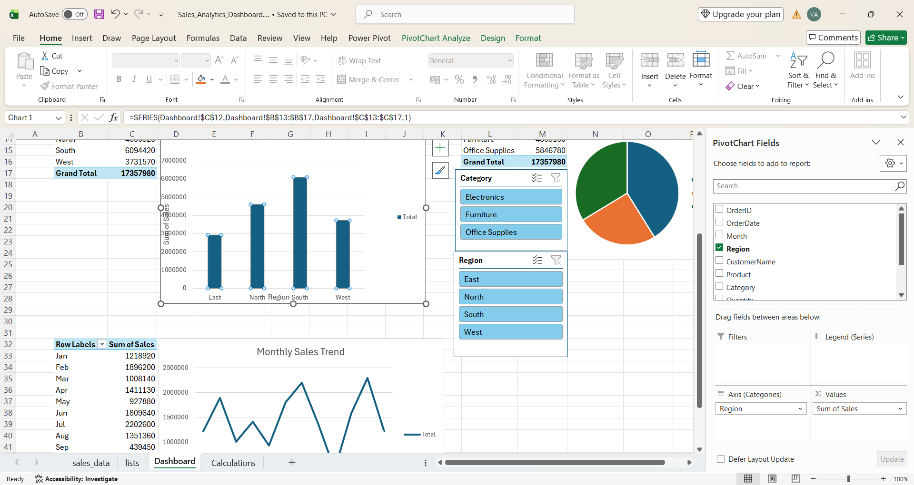
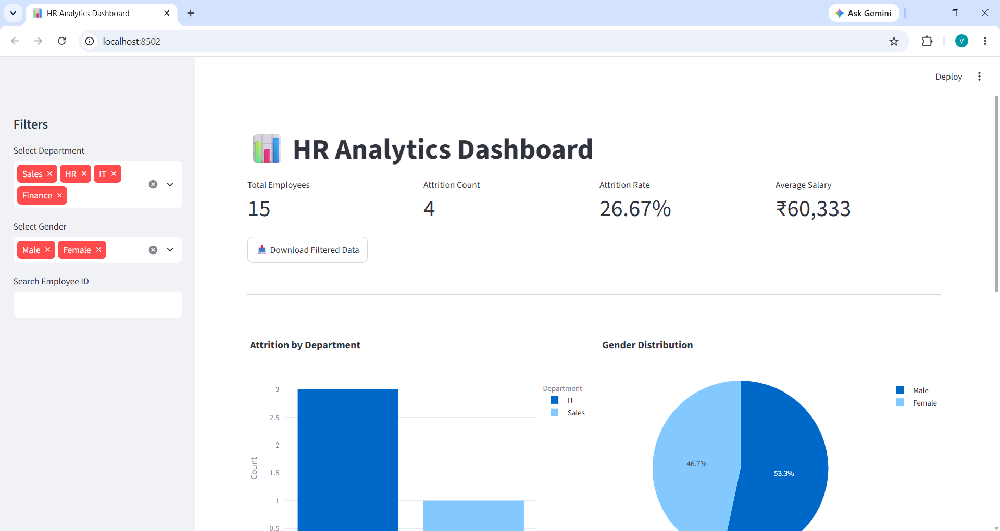

# Sales Analytics Dashboard

Interactive Sales Analytics Dashboard built using Microsoft Excel to analyze sales performance across regions, product categories, and time periods.

## Project Overview

This dashboard provides insights into sales performance through KPI cards, Pivot Tables, Pivot Charts, and Slicers. It helps track business performance and identify trends for better decision-making.

## Features

- Total Sales KPI
- Total Orders KPI
- Average Sales KPI
- Total Quantity Sold KPI
- Sales by Region Analysis
- Sales by Category Analysis
- Monthly Sales Trend Analysis
- Interactive Slicers for filtering data

## Tools Used

- Microsoft Excel
- Pivot Tables
- Pivot Charts
- Slicers
- Data Analysis
- Data Visualization

## Dashboard Preview

## Sales by Region

## Sales by Category

## Monthly Sales Trend

## Key Insights

- Analyzed sales performance across four regions.
- Compared revenue contribution by product category.
- Identified monthly sales trends and fluctuations.
- Created interactive visualizations for business reporting.

## Project Structure

Sales-Analytics-Dashboard/
│
├── Dashboard/
│ └── Sales_Analytics_Dashboard.xlsx
│
├── Screenshots/
│ ├── dashboard_overview.png
│ ├── sales_by_region.png
│ ├── sales_by_category.png
│ └── monthly_sales_tr